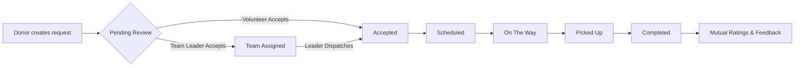
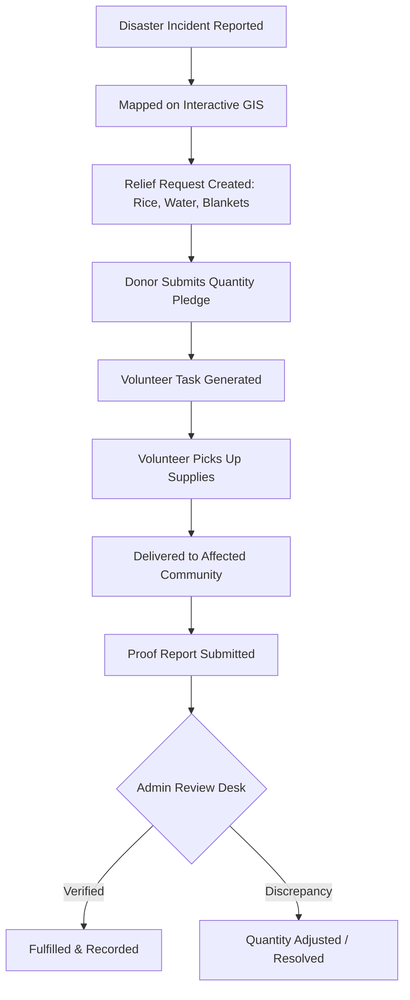

<div align="center">

# 🌉 PortionBridge

### *Connecting Hearts, Bridging Meals & Powering Disaster Relief*

A modern, full-stack platform designed to eliminate food and essential clothing waste while enabling rapid emergency response. PortionBridge coordinates donors, individual volunteers, organized volunteer teams, and field administrators across a unified, real-time lifecycle.

[](https://nodejs.org/)
[](https://react.dev/)
[](https://vitejs.dev/)
[](https://www.mysql.com/)
[](https://socket.io/)
[](https://tailwindcss.com/)
[](https://leafletjs.com/)

[Explore Features](#-key-features) • [Architecture](#-architecture--workflows) • [Quick Start](#-quick-start) • [Environment Variables](#-environment-variables) • [Testing](#-testing--quality) • [API Reference](#-api-documentation)

---
</div>

## 📌 Table of Contents
- [Overview](#-overview)
- [Key Features](#-key-features)
  - [1. Disaster Relief & Emergency Aid (New)](#1--disaster-relief--emergency-aid-new)
  - [2. Food & Clothes Donation Engine](#2--food--clothes-donation-engine)
  - [3. Volunteer Logistics & Team Dispatch](#3--volunteer-logistics--team-dispatch)
  - [4. Real-Time Chat & Notifications](#4--real-time-chat--notifications)
  - [5. Trust, Security & Concurrency Safety](#5--trust-security--concurrency-safety)
  - [6. Admin Oversight & Support Ticket Desk](#6--admin-oversight--support-ticket-desk)
- [Architecture & Workflows](#-architecture--workflows)
- [Tech Stack](#-tech-stack)
- [Project Structure](#-project-structure)
- [Quick Start](#-quick-start)
  - [Prerequisites](#prerequisites)
  - [Step 1: Database Setup](#step-1-database-setup)
  - [Step 2: Backend Setup](#step-2-backend-setup)
  - [Step 3: Frontend Setup](#step-3-frontend-setup)
- [Environment Variables](#-environment-variables)
- [Testing & Quality](#-testing--quality)
- [API Documentation](#-api-documentation)
- [Contributing & License](#-contributing--license)

---

## 🌟 Overview

Every year, millions of tons of edible food and wearable clothing are discarded, while vulnerable communities face acute shortages — especially during sudden environmental calamities like floods, cyclones, and cold waves.

**PortionBridge** bridges this critical gap with:
1. **Everyday Community Donations:** Allowing donors (individuals, restaurants, caterers) to post surplus food or clothing and having nearby volunteers quickly pick up and deliver them.
2. **Disaster Relief Management:** Empowering disaster responders and communities with nationwide incident monitoring, live GIS mapping, multi-item relief requests, donor supply pledges, and verified field deliveries.

---

## 🚀 Key Features

### 1. 🚨 Disaster Relief & Emergency Aid *(New)*
- **Nationwide Incident Monitoring:** Real-time logging of natural disasters (floods, cyclones, landslides, cold waves, fires, earthquakes) with severity levels (`low`, `medium`, `high`, `critical`) and verification statuses.
- **Interactive GIS Disaster Map:** High-performance Leaflet mapping with dynamic color-coded markers, pulse alerts for critical zones, district filtering across all 64 districts of Bangladesh, and clustering.
- **Multi-Item Relief Pledging:** Structured relief requests breakdown (dry foods, drinking water, medicine, emergency blankets) with exact unit arithmetic (kg, liters, units) and double-pledge prevention.
- **Volunteer Task Coordination:** Area-only privacy masking before task acceptance; detailed delivery proof reporting with notes and optional quantity adjustments.
- **Admin Verification Desk:** Dedicated moderation queue to verify delivery reports, inspect claims, resolve discrepancies, and adjust fulfilled quantities.

### 2. 🍲 Food & Clothes Donation Engine
- **Category Specifics:** Specialized fields for cooked food, perishable groceries, packaged items, and winter clothing.
- **Lifecycle Tracking:** Strict state-machine progression:
  $$\text{Pending} \longrightarrow \text{Accepted} \longrightarrow \text{Scheduled} \longrightarrow \text{On The Way} \longrightarrow \text{Picked Up} \longrightarrow \text{Completed}$$
- **Atomic Locking:** Concurrency-guarded database transactions (`SELECT ... FOR UPDATE`) prevent race conditions and double-claims when multiple volunteers click simultaneously.
- **Saved Pickup Addresses & Geo-Routing:** Radius-based discovery and location geocoding for hassle-free scheduling.

### 3. 👥 Volunteer Logistics & Team Dispatch
- **Individual or Team Mode:** Volunteers can work independently or organize into collaborative response teams.
- **Team Delegation:** Team leaders accept assignments and designate specific members for physical pickups; tracking and notifications seamlessly adapt to the assigned member.
- **Volunteer Discovery Radius:** Donors and organizers can search nearby active volunteers with vehicle types (bike, car, van, on-foot) and service availability.

### 4. 💬 Real-Time Chat & Notifications
- **Scoped Socket.IO Chat:** Instant, private chat channels dynamically created between the donor and the assigned volunteer/team member for each active donation.
- **Event-Driven Alerts:** Real-time push notifications for assignment updates, schedule changes, team invitations, and task verifications backed by MySQL database triggers.

### 5. 🛡️ Trust, Security & Concurrency Safety
- **State-of-the-Art Authentication:**
  - Short-lived JWT access tokens + rotating `httpOnly` refresh tokens.
  - Automatic replay detection (stale refresh token usage revokes the entire compromised session).
  - Google OAuth 2.0 integration with server-side ID token verification.
- **Brute-Force & Rate Limiting:** Tiered in-memory rate limiters protecting authentication endpoints with account lockouts on repeated failures.
- **Deep Image Verification:** Uploaded donation and profile images are inspected through MIME filtering, strict size limits, randomized UUID storage, and **magic-byte signature validation** (rejecting disguised malware payloads).
- **Mutual Ratings & Moderation:** Post-completion mutual ratings (1-5 stars) and automated community reporting against spam or violations.

### 6. 📊 Admin Oversight & Support Ticket Desk
- **Comprehensive Administration:** User management, role elevation, incident verification, and global platform statistics.
- **Ticketing System:** Full support ticket desk allowing users to file inquiries or dispute pickups, with threaded admin responses and status management (`open`, `in_progress`, `closed`).
- **Leaderboard & Achievements:** Gamified milestone badges and volunteer contribution leaderboards to motivate active community champions.

---

## 📐 Architecture & Workflows

### System Architecture
PortionBridge follows a layered, predictable MVC design:

```
[ Client: React 18 + Vite + Tailwind + Leaflet ]
                       │  HTTP REST / WebSocket (Socket.IO)
                       ▼
            [ Express.js Gateway ]
                       │
       ┌───────────────┼───────────────┐
       ▼               ▼               ▼
 [ Rate Limiters ] [ Auth / JWT ] [ File Uploads / Multer ]
       │               │               │
       └───────────────┼───────────────┘
                       ▼
             [ API Routers (v1) ]
                       │
          [ express-validator Rules ]
                       │
          [ Thin Controller Layer ]
                       │
         [ Business Services Layer ]
                       │
        [ Raw-SQL Data Models (mysql2) ]
                       │
            [ MySQL 8.0+ Database ]
       (Triggers, Audit Logs, Row-Level Locks)
```

### Donation Lifecycle Flowchart


### Disaster Relief Coordination Flowchart


---

## 🛠 Tech Stack

| Domain | Technologies & Libraries |
|---|---|
| **Frontend** | React 18, Vite 6, Tailwind CSS, Lucide Icons, React Router v6, Axios, Leaflet & React-Leaflet |
| **Backend** | Node.js, Express.js, Socket.IO, JWT, bcrypt, Multer, express-validator, Google Auth Library |
| **Database** | MySQL 8.0+ (Raw SQL via `mysql2/promise` with transactions & row-level locks — no bulky ORM overhead) |
| **Testing** | Vitest & React Testing Library (Client), Node.js Native Test Runner (`node --test`) & Supertest (Server) |
| **Documentation** | Swagger UI (`/api-docs`), OpenAPI Specification |

---

## 📂 Project Structure

```
PortionBridge/
├── portionbridge/
│   ├── client/                      # Frontend Application (React 18 + Vite)
│   │   ├── src/
│   │   │   ├── components/          # Reusable UI (dashboard, relief, ui widgets)
│   │   │   ├── context/             # AuthContext, SocketContext
│   │   │   ├── hooks/               # Custom React hooks (useApiResource, useGeolocation)
│   │   │   ├── pages/               # Route views (DisasterRelief, Donations, Admin, etc.)
│   │   │   ├── services/            # API client layer (Axios endpoints)
│   │   │   └── utils/               # Bangladesh districts, quantity helpers, validators
│   │   └── vitest.config.js         # Vitest configuration & test setup
│   │
│   ├── server/                      # Backend Application (Node.js + Express)
│   │   ├── config/                  # DB pool connection, CORS, relief settings
│   │   ├── constants/               # Status enums, units, role constants
│   │   ├── controllers/             # Request handlers
│   │   ├── middleware/              # Auth guard, rate-limit, upload, error handlers
│   │   ├── models/                  # SQL queries (raw mysql2)
│   │   ├── routes/v1/               # API endpoint definitions
│   │   ├── services/                # Core business logic (locking, pledges, tasks)
│   │   ├── sockets/                 # Socket.IO connection & event handlers
│   │   ├── tests/                   # Integration and unit tests
│   │   └── utils/                   # Password crypto, serializers, transaction helpers
│   │
│   └── database/                    # SQL Database Scripts
│       ├── main_schema.sql          # Complete, current MySQL database schema
│       ├── triggers.sql             # Notification & audit logging triggers
│       ├── dummy_data.sql           # Development seed data
│       └── migrations/              # Incremental SQL migration history
│
├── README.md                        # Project documentation
├── docker-compose.yml               # Container deployment configuration
└── setup_database.bat               # Windows quick setup script
```

---

## 🏁 Quick Start

### Prerequisites
- [Node.js](https://nodejs.org/) v18.0.0 or higher
- [MySQL](https://www.mysql.com/) 8.0+ (or MariaDB 10.2.1+ supporting `CHECK` constraints)
- Git

---

### Step 1: Database Setup

Log into your local MySQL server and initialize the schema, triggers, and optional seed data:

```bash
# 1. Import consolidated schema
mysql -u root -p < portionbridge/database/main_schema.sql

# 2. Add database triggers (triggers automatic status notifications)
mysql -u root -p portionbridge < portionbridge/database/triggers.sql

# 3. (Optional) Load development dummy data
mysql -u root -p portionbridge < portionbridge/database/dummy_data.sql
```

> [!NOTE]
> `main_schema.sql` represents the complete source of truth. You do not need to run older historical migrations for a clean installation.

---

### Step 2: Backend Setup

```bash
# Navigate to server
cd portionbridge/server

# Install dependencies
npm install

# Copy environment template
cp .env.example .env
```

Open `.env` in your editor and configure your database credentials and secrets (see [Environment Variables](#-environment-variables)).

```bash
# Verify schema state
npm run migrate

# Start development server
npm run dev
```
The API server will start on **`http://localhost:5000`**.

---

### Step 3: Frontend Setup

```bash
# Navigate to client
cd ../client

# Install dependencies
npm install

# Copy environment template
cp .env.example .env

# Start client development server
npm run dev
```
The client app will launch on **`http://localhost:5173`**.

---

## ⚙️ Environment Variables

### Backend Configuration (`server/.env`)

| Variable | Required | Default | Purpose / Notes |
|---|---|---|---|
| `PORT` | Optional | `5000` | Port for Express API server |
| `NODE_ENV` | Yes | `development` | `development` or `production` |
| `CLIENT_URL` | Yes | `http://localhost:5173` | Allowed frontend origin for CORS |
| `DB_HOST` | Yes | `localhost` | MySQL host address |
| `DB_PORT` | Optional | `3306` | MySQL port |
| `DB_USER` | Yes | `root` | Database username |
| `DB_PASSWORD` | Yes | — | Database password |
| `DB_NAME` | Yes | `portionbridge` | Database name |
| `JWT_ACCESS_SECRET` | Yes | — | Random secret (32+ chars) for access tokens |
| `JWT_ACCESS_EXPIRES_IN` | Optional | `15m` | Lifetime of access token |
| `JWT_REFRESH_SECRET` | Yes | — | Separate secret for rotating refresh tokens |
| `GOOGLE_CLIENT_ID` | Optional | — | Google OAuth client ID for social login |
| `EMAIL_USER` / `EMAIL_PASSWORD` | In Prod | — | SMTP credentials (emails logged to console in dev) |

### Frontend Configuration (`client/.env`)

| Variable | Required | Default | Notes |
|---|---|---|---|
| `VITE_API_BASE_URL` | Yes | `http://localhost:5000/api/v1` | Base REST endpoint |
| `VITE_SOCKET_URL` | Yes | `http://localhost:5000` | Socket.IO server URL |
| `VITE_GOOGLE_CLIENT_ID` | Optional | — | Google Client ID for OAuth button |

---

## 🧪 Testing & Quality

Both the frontend and backend have automated test suites covering critical security, quantity calculation, and UI user journeys:

### Run Client Tests (Vitest)
```bash
cd portionbridge/client
npm test
```
*Executes 220+ component and hook tests covering pledge dialogs, GIS disaster map interactions, filters, and role-based permissions.*

### Run Backend Tests (Node Test Runner)
```bash
cd portionbridge/server
npm run test:unit
```
*Executes unit tests verifying milli-arithmetic quantity parsing, password complexity checks, token security, and validation rules.*

---

## 📖 API Documentation

In development mode, explore and test the interactive OpenAPI/Swagger specification directly in your browser:

🔗 **`http://localhost:5000/api-docs`**

### Key REST Route Collections

- **`/api/v1/auth`** — Register, login, refresh tokens, Google OAuth, password recovery.
- **`/api/v1/donations`** — Food and clothing donation CRUD, lifecycle status updates, acceptance locking.
- **`/api/v1/relief`** — Disaster incident listings, GIS coordinates, multi-item requests, pledges, volunteer tasks, and admin review queue.
- **`/api/v1/teams`** — Team creation, member invites, roster management, and leadership handover.
- **`/api/v1/support`** — User support ticket management and threaded messaging.
- **`/api/v1/users`** — User profiles, saved pickup addresses, and avatar uploads.

---

## 🤝 Contributing & Community

Contributions are what make the open-source community an incredible place to learn, inspire, and create.
1. Fork the Project
2. Create your Feature Branch (`git checkout -b feature/AmazingFeature`)
3. Commit your Changes (`git commit -m 'feat: Add some AmazingFeature'`)
4. Push to the Branch (`git push origin feature/AmazingFeature`)
5. Open a Pull Request

---

## 📄 License

Distributed under the MIT License. See `LICENSE` for more information.

<div align="center">
  <sub>Built with ❤️ for resilient communities by <a href="https://github.com/TaohidBhuiyan">Taohid Bhuiyan</a> and community contributors.</sub>
</div>


## Disaster response — documentation index
- Setup, migration order, backup/rollback, Git procedure, pre-deploy checks: `docs/SETUP_AND_DEPLOYMENT.md`
- Final audit (verified results, issues, limitations): `docs/FINAL_AUDIT_REPORT.md`
- Status models and valid transitions: `docs/STATUS_TRANSITIONS.md`
- Alerts (Phase 4): `docs/DISASTER_ALERTS_PHASE4_IMPLEMENTATION.md` · Admin operations (Phase 5): `docs/ADMIN_OPERATIONS_PHASE5_IMPLEMENTATION.md`
